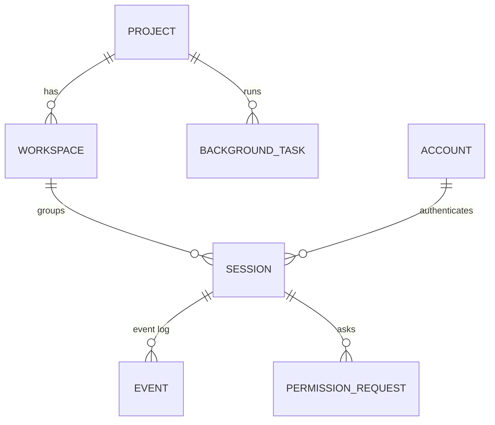
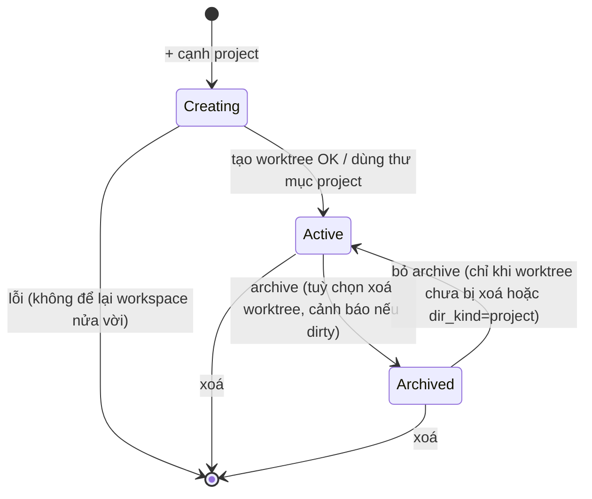
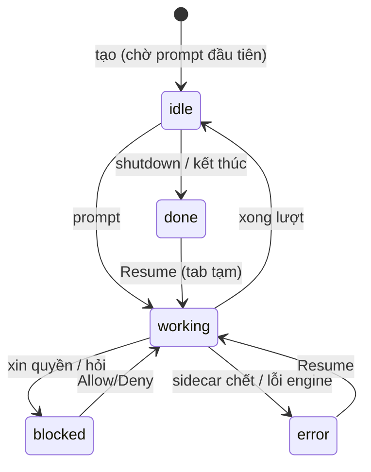

# Data Model — Herdsman (001-herdsman-use-cases)

Nguồn sự thật:
- **Tiến trình và trạng thái chạy**: `hc` (terminal + label `herdsman.*`).
- **Hội thoại**: event log `<app data>/sessions/<sid>/events.ndjson` (append-only, `seq` tăng dần) + transcript gốc của engine.
- **Tổ chức và metadata**: SQLite `<app data>/herdsman.db`. SQLite là cache/index; mất DB vẫn dựng lại được project/session từ label `hc`.

## Project

| Field | Kiểu | Ràng buộc |
|---|---|---|
| id | TEXT (ULID) | PK |
| name | TEXT | bắt buộc; mặc định = tên thư mục |
| path | TEXT | bắt buộc, tuyệt đối, đã chuẩn hoá (realpath); **UNIQUE** (FR-002) |
| sort | INTEGER | thứ tự trong sidebar |
| created_at | INTEGER | epoch ms |

- Thư mục không còn tồn tại → trạng thái suy ra `missing` (không lưu), chặn tạo session mới.
- Xoá: theo FR-002a / research R5.

## Workspace

| Field | Kiểu | Ràng buộc |
|---|---|---|
| id | TEXT (ULID) | PK |
| project_id | TEXT | FK → Project, ON DELETE CASCADE |
| name | TEXT NULL | NULL cho tới prompt đầu tiên; sau đó = dòng đầu prompt, cắt ~40 ký tự (FR-006) |
| dir_kind | TEXT | `project` \| `worktree` |
| work_dir | TEXT | = project.path nếu `project`; đường dẫn worktree nếu `worktree` |
| branch | TEXT NULL | bắt buộc khi `worktree` |
| base_branch | TEXT NULL | bắt buộc khi `worktree` |
| archived_at | INTEGER NULL | khác NULL = đã archive (FR-008a) |
| worktree_removed | INTEGER (bool) | worktree đã bị xoá khi archive |
| created_at | INTEGER | |

Ràng buộc: `UNIQUE(project_id, branch)` khi `dir_kind = worktree`.

**Vòng đời**

## Session

| Field | Kiểu | Ràng buộc |
|---|---|---|
| id | TEXT | PK; = session id của engine (Claude session id / Codex thread id) khi đã có, trước đó là ULID tạm được thay khi engine trả id |
| workspace_id | TEXT | FK → Workspace, ON DELETE CASCADE |
| engine | TEXT | `claude` \| `codex` |
| account_id | TEXT NULL | FK → Account |
| hc_terminal | TEXT NULL | địa chỉ terminal `hc` hiện tại |
| title | TEXT NULL | |
| status | TEXT | cache của `hc`: `idle` \| `working` \| `blocked` \| `done` \| `error` |
| permission_mode | TEXT | `ask` \| `accept_edits` \| `bypass`; mặc định `ask` (FR-022a) |
| model | TEXT NULL | |
| last_seen_seq | INTEGER | seq cuối app đã nhận; không reset khi resume |
| pinned_tab | INTEGER (bool) | đang hiện trên hàng tab |
| created_at / updated_at / ended_at | INTEGER | |

**Trạng thái**

## Event (event log, không nằm trong SQLite)

Một dòng NDJSON: `{seq, ts, type, payload}`. `type` thuộc `AgentEvent` chuẩn hoá (xem [contracts/sidecar-socket.md](./contracts/sidecar-socket.md)). Delta stream không ghi log.

## PermissionRequest

Lưu trong event log (`permission_request` / `permission_resolved`); app dựng hàng đợi từ log.

| Field | Ý nghĩa |
|---|---|
| id | id request |
| session_id | |
| tool | `Edit`, `Write`, `Bash`, … |
| input | tham số tool (diff/lệnh dựng từ đây) |
| decision | `pending` \| `allow` \| `deny` |

Không có timeout (FR-023).

## Account

| Field | Kiểu | Ràng buộc |
|---|---|---|
| id | TEXT | PK |
| label | TEXT | |
| engine | TEXT | `claude` \| `codex` |
| config_dir | TEXT | `CLAUDE_CONFIG_DIR` / `CODEX_HOME` |
| uses_api_key | INTEGER (bool) | key nằm trong Keychain, không bao giờ trong SQLite |

## BackgroundTask (không lưu SQLite)

Suy từ terminal `hc` có label `herdsman.kind=task`, `herdsman.project=<pid>`: lệnh, trạng thái, địa chỉ terminal. Dọn = `terminal.rm`.

## AgentNode (không lưu)

Cây dựng từ `parent`/`children` của terminal `hc`, gốc là terminal của session. Trường: địa chỉ terminal, tên/lệnh, `Status {state, kind, msg, progress}`.

## Chỉ mục tìm kiếm

`message_fts` (FTS5): `session_id UNINDEXED, workspace_id UNINDEXED, project_id UNINDEXED, seq UNINDEXED, text`. Xoá workspace/project xoá dòng tương ứng; archive giữ nguyên (FR-028).
