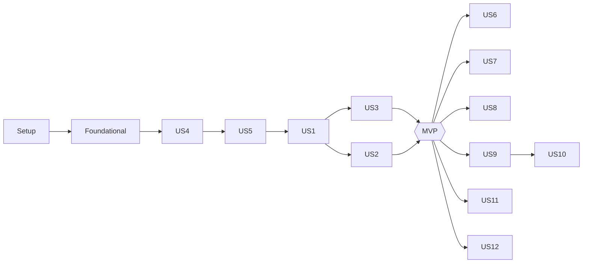

---

description: "Task list — Herdsman: GUI quản lý agent theo Project → Workspace → Session"
---

# Tasks: Herdsman — GUI quản lý agent theo Project → Workspace → Session

**Input**: Design documents from `/specs/001-herdsman-use-cases/`

**Prerequisites**: [plan.md](./plan.md), [spec.md](./spec.md), [research.md](./research.md), [data-model.md](./data-model.md), [contracts/](./contracts/), [quickstart.md](./quickstart.md)

**Tests**: Có. Constitution (mục "Quy trình phát triển & cổng chất lượng") bắt buộc: contract test cho socket sidecar và lệnh `hc`; smoke test Agent SDK; test tích hợp cho 3 tiêu chí chính của BR; test tái hiện app tắt giữa chừng cho thay đổi chạm persistence/permission/giao thức. Các test khác không viết thêm.

**Organization**: Theo user story. Năm story P1 xếp theo thứ tự phụ thuộc: US4 → US5 → US1 → US3 → US2 (session cần workspace, workspace cần project).

## Format: `[ID] [P?] [Story] Description`

- **[P]**: chạy song song được (file khác nhau, không phụ thuộc task chưa xong)
- **[Story]**: user story trong spec.md (US1…US12)

## Path Conventions

- Rust backend: `src-tauri/src/`, migrations `src-tauri/migrations/`, test `src-tauri/tests/`
- Sidecar Node: `sidecar/src/`, test `sidecar/test/`
- Frontend: `src/`, test `tests/unit/`, `tests/e2e/`

---

## Phase 1: Setup (Shared Infrastructure)

**Purpose**: Khởi tạo repo Tauri 2 + sidecar + frontend theo cấu trúc trong plan.md

- [X] T001 Khởi tạo app Tauri 2 (React + TypeScript, pnpm) ở gốc repo với `src/` và `src-tauri/` (crate tên `herdsman`), identifier `app.herdsman`, cấu hình trong src-tauri/tauri.conf.json
- [X] T002 Thêm dependency Rust (tokio full, serde, serde_json, sqlx sqlite+runtime-tokio+macros, thiserror, tracing, ulid, specta/tauri-specta, tauri-plugin-notification, tauri-plugin-dialog) vào src-tauri/Cargo.toml
- [X] T003 [P] Thêm dependency frontend (zustand, immer, @tanstack/react-query, @tanstack/react-virtual, react-markdown, remark-gfm, remark-math, rehype-katex, rehype-sanitize, katex, shiki, mermaid, vega-embed, @codemirror/merge, @xterm/xterm, lucide-react) vào package.json
- [X] T004 [P] Cài Tailwind CSS v4 và khởi tạo shadcn/ui (style "new-york", base color zinc, CSS variables) với components.json và src/styles/globals.css
- [X] T005 [P] Đóng gói font Geist và Geist Mono (woff2) vào src/assets/fonts/ và khai báo `@font-face` trong src/styles/fonts.css (không tải Google Fonts lúc chạy — research R3)
- [X] T006 [P] Khởi tạo package sidecar `herdsman-agent` (ESM, Node 20, dependency `@anthropic-ai/claude-agent-sdk` ghim phiên bản cụ thể) trong sidecar/package.json, thêm vào pnpm-workspace.yaml
- [ ] T007 [P] Cấu hình lint/format: rustfmt + clippy (src-tauri/rustfmt.toml), ESLint + Prettier (eslint.config.js, .prettierrc), Vitest (vitest.config.ts)
- [ ] T008 Cấu hình đóng gói Node runtime làm Tauri sidecar binary và `sidecar/` làm resource trong src-tauri/tauri.conf.json (`bundle.externalBin`, `bundle.resources`)

---

## Phase 2: Foundational (Blocking Prerequisites)

**Purpose**: Hạ tầng dùng chung: PoC rủi ro, SQLite, `hc` client, sidecar lõi + giao thức socket, agent client, layout, theme

**⚠️ CRITICAL**: Không bắt đầu user story nào trước khi xong phase này

### PoC rủi ro (research R10)

- [X] T009 PoC cú pháp OSC 7501: script ghi status `working`/`blocked`/`idle` ra stdout trong terminal `hc`, kiểm tra `hc ls`/`hc get` thấy đúng; ghi kết quả (cú pháp byte hoặc "không khả dụng") vào specs/001-herdsman-use-cases/research.md mục R10
- [X] T010 PoC sidecar Node chạy bằng `hc run --bg` mở Unix socket, app giả (script) ngắt/nối lại socket sau khi tắt; ghi kết quả vào specs/001-herdsman-use-cases/research.md mục R10

### Lưu trữ

- [X] T011 Viết migration đầu tiên src-tauri/migrations/0001_init.sql theo data-model.md: `projects(id, name, path UNIQUE, sort, created_at)`, `workspaces(id, project_id FK ON DELETE CASCADE, name NULL, dir_kind CHECK IN ('project','worktree'), work_dir, branch NULL, base_branch NULL, archived_at NULL, worktree_removed, created_at, UNIQUE(project_id, branch))`, `sessions(id, workspace_id FK ON DELETE CASCADE, engine CHECK IN ('claude','codex'), account_id NULL, hc_terminal NULL, title NULL, status CHECK IN ('idle','working','blocked','done','error'), permission_mode CHECK IN ('ask','accept_edits','bypass') DEFAULT 'ask', model NULL, last_seen_seq, pinned_tab, created_at, updated_at, ended_at NULL)`, `accounts(id, label, engine, config_dir, uses_api_key)`, `message_fts` FTS5 (`session_id UNINDEXED, workspace_id UNINDEXED, project_id UNINDEXED, seq UNINDEXED, text`)
- [X] T012 Tạo pool SQLite + chạy migration khi khởi động, đường dẫn `<app data>/herdsman.db`, trong src-tauri/src/store/mod.rs
- [X] T013 [P] Định nghĩa kiểu lỗi chung `{code, message}` trả về cho UI (serde + specta) trong src-tauri/src/error.rs
- [ ] T014 [P] Cấu hình tracing ra file `<app data>/logs/` và lọc không ghi prompt/nội dung hội thoại/credential vào log thường trong src-tauri/src/logging.rs

### `hc` client (contracts/hc-integration.md)

- [ ] T015 Sinh kiểu Rust từ `hc schema` (script build) vào src-tauri/src/hc_client/types.rs
- [X] T016 Kết nối socket `hc` (lấy từ `hc server status`, fallback `hc connect` qua stdio), `hello` kiểm tra protocol generation 1, gọi JSON-RPC trong src-tauri/src/hc_client/mod.rs
- [X] T017 `events.subscribe` lọc label `herdsman.app=1`, phát event `status://changed` và `hc://connection` lên UI, tự kết nối lại với backoff trong src-tauri/src/hc_client/events.rs
- [X] T018 [P] Contract test `hc`: run có label → list thấy; đóng kết nối → terminal vẫn live; kill → finished; rm → biến mất (contracts/hc-integration.md test 1, 2, 4) trong src-tauri/tests/hc_contract.rs

### Sidecar lõi (contracts/sidecar-socket.md)

- [X] T019 Entry sidecar: đọc args `--session --cwd --engine --permission-mode [--resume]`, chọn engine, mở socket `<app data>/sock/<sid>.sock` trong sidecar/src/index.mjs
- [X] T020 [P] Event log append-only NDJSON `{seq, ts, type, ...}`, `seq` tăng dần, khôi phục `seq` cuối khi khởi động lại (không reset), không ghi `delta`, trong sidecar/src/eventlog.mjs
- [X] T021 [P] Server socket NDJSON: `hello{proto:1}` (sai proto → `error proto_mismatch` rồi đóng), `subscribe{from_seq}` phát lại `seq > from_seq` rồi `live` rồi stream trực tiếp, nhiều client, trong sidecar/src/socket.mjs
- [X] T022 [P] Ghi status OSC 7501 ra stdout theo kết quả T009 (hoặc no-op nếu không khả dụng) trong sidecar/src/osc.mjs
- [X] T023 [P] In log dạng chữ dễ đọc (ai nói gì, tool nào chạy) ra màn hình terminal cho `hc read`/`hc attach` trong sidecar/src/screen.mjs
- [X] T024 Contract test socket: replay đúng từ `from_seq`, ngắt/nối lại không mất event, sai proto bị từ chối (contracts/sidecar-socket.md test 1, 2, 5) trong sidecar/test/socket.contract.test.mjs

### Agent client (Rust ↔ sidecar)

- [X] T025 Chạy sidecar qua `terminal.run` (argv, `cwd = workspace.work_dir`, `outlive_parent: true`, env tài khoản, label `herdsman.app/kind/project/workspace/session/engine`) trong src-tauri/src/agent_client/spawn.rs
- [X] T026 Kết nối socket theo session, `subscribe{from_seq = last_seen_seq}`, gom event thành batch 16–50 ms phát `session://events`, cập nhật `sessions.last_seen_seq`, retry backoff khi `hc` báo live mà socket chưa sẵn sàng, trong src-tauri/src/agent_client/mod.rs
- [X] T027 [P] Định nghĩa kiểu `AgentEvent` (Rust + export TypeScript) đúng bảng trong contracts/sidecar-socket.md, trong src-tauri/src/agent_client/events.rs và src/lib/types.ts

### Khung UI

- [X] T028 [P] Token màu zinc Light/Dark theo BR 3.2 (nền, viền, chữ, chữ phụ; xanh lá/vàng/đỏ cho trạng thái), bo góc 6/8/12px, font Geist/Geist Mono, trong src/styles/globals.css
- [X] T029 [P] Thêm component shadcn dùng chung (button, input, tabs, dialog, alert-dialog, badge, card, scroll-area, tooltip, popover, dropdown-menu, select, command) vào src/components/ui/
- [X] T030 Layout 3 cột (Sidebar trái, khung giữa: WorkspaceBar + SessionTabs + vùng hội thoại, RightPanel: Agents/Background/Files/Log) dạng khung rỗng trong src/components/layout/AppShell.tsx
- [X] T031 [P] Theme: `system | light | dark`, mặc định theo hệ điều hành, nút đổi ở sidebar, lưu qua `settings_get/settings_set` trong src/components/layout/ThemeToggle.tsx và src-tauri/src/commands/settings.rs
- [X] T032 [P] Wrapper `invoke` có kiểu + QueryClient trong src/lib/api.ts; hiện trạng thái kết nối `hc` (`hc_status`, `hc://connection`) ở chân sidebar trong src/components/layout/HcStatus.tsx

**Checkpoint**: App mở được, nối `hc`, chạy được sidecar rỗng và nhận event qua socket

---

## Phase 3: User Story 4 - Quản lý project (Priority: P1) 🎯 MVP

**Goal**: Thêm / đổi tên / xoá project bằng thư mục local; sidebar liệt kê project

**Independent Test**: Thêm 2 project từ 2 thư mục, đổi tên 1, xoá 1; thêm trùng thư mục bị từ chối; khởi động lại app thông tin còn nguyên (quickstart #1)

- [X] T033 [P] [US4] Repository project (list, insert với `path` chuẩn hoá realpath và UNIQUE → lỗi `already_exists`, rename, delete) trong src-tauri/src/store/projects.rs
- [X] T034 [US4] Command `project_list` (kèm `missing` khi thư mục không còn), `project_add` (lỗi `not_a_directory`), `project_rename` trong src-tauri/src/commands/project.rs
- [X] T035 [US4] Command `project_delete_preview` (terminal `hc` còn live có label `herdsman.project=<pid>`) và `project_delete{confirm:true}`: kill → chờ finished → rm → xoá dữ liệu app, không đụng thư mục project và transcript (FR-002a) trong src-tauri/src/commands/project.rs
- [X] T036 [P] [US4] `useProjectStore` (lựa chọn project/workspace/session, persist lựa chọn gần nhất) trong src/stores/useProjectStore.ts
- [X] T037 [US4] Sidebar: nút "+ Project mới" (dialog chọn thư mục), danh sách project có thể thu gọn, menu đổi tên/xoá, cảnh báo project `missing`, trong src/components/layout/Sidebar.tsx
- [X] T038 [US4] Hộp xác nhận xoá project liệt kê session/task đang chạy (từ `project_delete_preview`) trong src/components/project/DeleteProjectDialog.tsx

**Checkpoint**: Quản lý project chạy độc lập

---

## Phase 4: User Story 5 - Tạo workspace kèm session đầu tiên (Priority: P1) 🎯 MVP

**Goal**: + cạnh project tạo workspace (thư mục project) kèm 1 session trống; tên tự đặt theo prompt đầu; thêm session bằng + cạnh hàng tab; archive/xoá workspace

**Independent Test**: Tạo workspace để trống tên, gửi prompt đầu → workspace có tên theo prompt; thêm session thứ hai; archive rồi bỏ archive; xoá (quickstart #2, phần workspace)

- [X] T039 [P] [US5] Repository workspace (create, rename, list theo project có/không archived, set `archived_at`, delete) trong src-tauri/src/store/workspaces.rs
- [X] T040 [P] [US5] Repository session (create với `permission_mode` mặc định `'ask'`, update status/title/last_seen_seq/pinned_tab, list theo workspace mới nhất trước) trong src-tauri/src/store/sessions.rs
- [X] T041 [US5] Command `workspace_create` với `dir.kind = "project"` (work_dir = project.path) tạo workspace + session trống trong một transaction; `workspace_rename`; `workspace_list` trong src-tauri/src/commands/workspace.rs
- [X] T042 [US5] Đặt tên workspace tự động: khi prompt đầu tiên của workspace `name = NULL` được gửi, lấy dòng đầu, cắt ~40 ký tự (FR-006) trong src-tauri/src/commands/session.rs
- [X] T043 [US5] Command `workspace_archive` / `workspace_unarchive` / `workspace_delete` (xoá SQLite + `<app data>/sessions/<sid>/` + dòng FTS, không đụng thư mục project/transcript) trong src-tauri/src/commands/workspace.rs
- [X] T044 [US5] Dialog tạo workspace (tên tuỳ chọn, thư mục làm việc: thư mục project / worktree mới — tuỳ chọn worktree hiện disabled tới US7) trong src/components/workspace/CreateWorkspaceDialog.tsx
- [X] T045 [US5] Workspace trong sidebar (icon ▢ thư mục project, ẩn archived) + nút + cạnh tên project trong src/components/layout/Sidebar.tsx
- [X] T046 [US5] WorkspaceBar `project › workspace`, chip "thư mục project", model, ctx trong src/components/layout/WorkspaceBar.tsx
- [X] T047 [US5] SessionTabs: chỉ session chưa xong + session đang xem, nút + thêm session, chỗ cho icon lịch sử, trong src/components/layout/SessionTabs.tsx
- [X] T048 [US5] Màn chờ prompt đầu tiên cho session trống trong src/components/conversation/EmptySession.tsx
- [X] T049 [US5] Menu workspace: archive / bỏ archive / xoá (alert-dialog xác nhận) trong src/components/workspace/WorkspaceMenu.tsx

**Checkpoint**: Có project → workspace → session (chưa chạy agent thật)

---

## Phase 5: User Story 1 - Mở session agent và xem hội thoại dạng GUI (Priority: P1) 🎯 MVP

**Goal**: Session Claude chạy thật, stream realtime, render markdown/code/bảng/Mermaid/chart/KaTeX, tool card + diff, gửi tin/ảnh/slash, interrupt

**Independent Test**: Prompt yêu cầu bảng + Mermaid + chart → hiện đúng, chữ hiện dần; Mermaid lỗi hiện source; interrupt dừng lượt (quickstart #2, #3)

### Tests for User Story 1

- [X] T050 [P] [US1] Smoke test Agent SDK (port `devdy/sidecar/test-smoke.mjs`): một lượt prompt → nhận `assistant_message` + `turn_end` trong sidecar/test/smoke.claude.test.mjs
- [X] T051 [P] [US1] Test tích hợp render: khối Mermaid hợp lệ → SVG; khối ` ```chart ` → biểu đồ; khối lỗi → hiện source (tiêu chí chính BR #2) trong tests/unit/conversation/render.test.tsx

### Implementation for User Story 1

- [X] T052 [US1] Engine Claude: `query()` với input async iterable, `includePartialMessages`, `resume`, chuẩn hoá message SDK → `AgentEvent` (`session_started`, `user_message`, `delta`, `assistant_message`, `tool_use`, `tool_result`, `turn_end`, `error`) trong sidecar/src/engines/claude.mjs
- [X] T053 [US1] Xử lý lệnh `prompt{text, images}`, `interrupt`, `set_model`, `shutdown` trong sidecar/src/commands.mjs
- [X] T054 [US1] Cập nhật id session tạm (ULID) thành session id của engine khi `session_started`, đổi label `herdsman.session` qua `terminal.label`, trong src-tauri/src/agent_client/mod.rs
- [X] T055 [US1] Command `session_create`, `session_open`, `session_close_view`, `session_prompt`, `session_interrupt` trong src-tauri/src/commands/session.rs
- [X] T056 [P] [US1] `useSessionStore` (immer + subscribeWithSelector): `messages` theo `seq`, message tạm đang stream, `applyEvents(sid, events)`, giải phóng khi đóng tab trong src/stores/useSessionStore.ts
- [X] T057 [US1] MessageList dùng @tanstack/react-virtual, subscribe theo selector từng message để delta chỉ re-render message đang chạy, trong src/components/conversation/MessageList.tsx
- [X] T058 [P] [US1] Markdown an toàn: react-markdown + remark-gfm + remark-math/rehype-katex + rehype-sanitize, không `dangerouslySetInnerHTML` (FR-015) trong src/components/conversation/Markdown.tsx
- [X] T059 [P] [US1] Code block Shiki (lazy theo ngôn ngữ, theme theo Light/Dark) trong src/components/conversation/CodeBlock.tsx
- [X] T060 [P] [US1] Mermaid render trong Web Worker, cache theo hash + theme, render khi vào viewport, lỗi → hiện source (FR-014) trong src/components/conversation/Mermaid.tsx và src/workers/mermaid.worker.ts
- [X] T061 [P] [US1] Khối ` ```chart ` (Vega-Lite) bằng vega-embed, lazy theo viewport, lỗi → hiện source trong src/components/conversation/Chart.tsx
- [X] T062 [P] [US1] ToolCard thu gọn được cho `Bash`, `Read`, `Edit`/`Write` (diff bằng @codemirror/merge), `Task`, trong src/components/conversation/ToolCard.tsx và src/components/conversation/Diff.tsx
- [X] T063 [US1] Composer: textarea, dán ảnh (base64 + media_type), gợi ý slash command, nút gửi/interrupt trong src/components/composer/Composer.tsx

**Checkpoint**: MVP xem hội thoại GUI chạy được với session Claude

---

## Phase 6: User Story 3 - Duyệt quyền tool của agent (Priority: P1) 🎯 MVP

**Goal**: Hộp Allow/Deny có diff/lệnh; 3 chế độ quyền; request chờ không hết hạn khi app tắt

**Independent Test**: Prompt sửa file → diff → Allow chạy tiếp ≤2 s; Deny không đổi file; đổi chế độ Tự cho phép sửa file / Bỏ qua mọi duyệt (quickstart #4, #7, #8)

### Tests for User Story 3

- [X] T064 [P] [US3] Contract test: `permission_request` khi không có client → sidecar chờ; client nối lại nhận request; `allow` → engine chạy tiếp (contracts/sidecar-socket.md test 3) trong sidecar/test/permission.contract.test.mjs
- [X] T065 [P] [US3] Test tích hợp tiêu chí chính BR #3: agent xin `Edit` → UI nhận request có diff → Allow → `tool_result` thành công, trong src-tauri/tests/permission_flow.rs

### Implementation for User Story 3

- [X] T066 [US3] `canUseTool`: ghi `permission_request{id, tool, input, cwd}` vào log, promise chờ không giới hạn, `permission_response` → `permission_resolved{by:"user"}`, `unknown_request` khi id sai, trong sidecar/src/permissions.mjs
- [X] T067 [US3] `set_permission_mode`: ánh xạ `ask→default`, `accept_edits→acceptEdits`, `bypass→bypassPermissions` (research R2), ghi `permission_mode_changed`, trong sidecar/src/engines/claude.mjs
- [X] T068 [US3] Command `session_permission` và `session_set_permission_mode` (`bypass` thiếu `confirm_bypass` → lỗi `confirm_required`; lưu `sessions.permission_mode`) trong src-tauri/src/commands/session.rs
- [X] T069 [P] [US3] `usePermissionStore`: request còn treo theo session dựng từ event log (request chưa có `permission_resolved`), chế độ hiện tại, trong src/stores/usePermissionStore.ts
- [X] T070 [US3] PermissionDialog: diff cho `Edit`/`Write`, lệnh đầy đủ cho `Bash`, nút Allow/Deny, mỗi session hộp riêng, trong src/components/permission/PermissionDialog.tsx
- [X] T071 [US3] ModeSwitcher trong composer (3 chế độ, alert-dialog xác nhận cho Bỏ qua mọi duyệt) + badge cảnh báo trên tab session khi `bypass` (FR-022b) trong src/components/permission/ModeSwitcher.tsx và src/components/layout/SessionTabs.tsx

**Checkpoint**: Agent chỉ chạy tool cần quyền khi developer cho phép hoặc theo chế độ đã chọn

---

## Phase 7: User Story 2 - Agent vẫn chạy khi tắt app, mở lại thấy đầy đủ (Priority: P1) 🎯 MVP

**Goal**: Tắt/crash/update app không ảnh hưởng agent; mở lại tự nối và đầy đủ; resume khi sidecar chết

**Independent Test**: Task dài → quit app 10 phút → mở lại: đủ tin nhắn, agent tiếp tục, trạng thái đúng (quickstart #5, #6)

### Tests for User Story 2

- [X] T072 [P] [US2] Contract test resume: kill sidecar, chạy lại `--resume` → `seq` tiếp tục từ giá trị cũ + 1 (contracts/sidecar-socket.md test 4) trong sidecar/test/resume.contract.test.mjs
- [X] T073 [P] [US2] Test tích hợp tiêu chí chính BR #1 (rút gọn thời gian): agent đang chạy → dừng backend Rust → sidecar vẫn live trong `hc` → khởi động lại backend → replay đủ event từ `last_seen_seq`, trạng thái đúng; kèm kịch bản permission đang chờ khi app tắt; trong src-tauri/tests/app_restart.rs

### Implementation for User Story 2

- [X] T074 [US2] Khôi phục khi mở app: `terminal.list` lọc `herdsman.app=1`, đối chiếu SQLite (thêm session thiếu từ label, đánh dấu terminal mất), cập nhật status cho mọi session trong src-tauri/src/agent_client/recover.rs
- [X] T075 [US2] Command `session_resume`: terminal `finished`/mất → chạy lại sidecar với `--resume` (engine nạp transcript gốc), giữ `seq` trong src-tauri/src/commands/session.rs
- [X] T076 [US2] Mở lại session/tab đang xem gần nhất khi khởi động, nút Resume cho session error/terminal mất, trong src/components/conversation/SessionView.tsx
- [X] T077 [US2] Theo dõi thời gian khôi phục (log tracing đo từ khởi động tới khi mọi session có status) để kiểm SC-008 trong src-tauri/src/agent_client/recover.rs

**Checkpoint**: Toàn bộ P1 (MVP) xong — chạy quickstart #1–#8

---

## Phase 8: User Story 6 - Theo dõi trạng thái và nhận thông báo (Priority: P2)

**Goal**: Chấm trạng thái trên tab, chấm vàng ở sidebar, thông báo hệ điều hành

**Independent Test**: 2 session ở 2 workspace, một session xin quyền khi app chạy nền → chấm đổi ≤1 s, thông báo ≤2 s, bấm mở đúng session (quickstart #6)

- [X] T078 [P] [US6] `useStatusStore`: status mọi session từ `status://changed` (kể cả session chưa mở) trong src/stores/useStatusStore.ts
- [X] T079 [US6] Chấm màu idle/working/blocked/done/error trên tab (pulse khi working) trong src/components/layout/SessionTabs.tsx
- [X] T080 [US6] Chấm vàng cạnh workspace có session blocked/error trong src/components/layout/Sidebar.tsx
- [ ] T081 [US6] Thông báo hệ điều hành khi chuyển `done`/`blocked`/`error` và cửa sổ không focus, payload `session_id`, click → focus + mở session (`notification://clicked`) trong src-tauri/src/notify.rs và src/lib/notifications.ts

---

## Phase 9: User Story 7 - Workspace trên worktree riêng, chạy song song (Priority: P2)

**Goal**: Tạo workspace với worktree mới từ base branch; archive/xoá có kiểm tra thay đổi chưa commit

**Independent Test**: 2 workspace worktree cùng sửa một file → 2 branch riêng, thư mục gốc không đổi; archive worktree dirty → cảnh báo (quickstart #9, #10)

- [X] T082 [P] [US7] Module git qua CLI: `branches`, `worktree_add(-b branch, path, base)` tại `<project>/../.herdsman-worktrees/<project-name>/<workspace-slug>` (fallback `<app data>/worktrees/…`), `status --porcelain`, `worktree_remove [--force]` trong src-tauri/src/git/mod.rs
- [X] T083 [US7] `workspace_create` với `dir.kind = "worktree"`: kiểm tra `base_not_found`/`branch_exists`, tạo worktree, rollback khi lỗi (không để workspace nửa vời) trong src-tauri/src/commands/workspace.rs
- [X] T084 [US7] `workspace_dirty_check`; `workspace_archive`/`workspace_delete` với `remove_worktree` (dirty mà thiếu `confirm_dirty` → `dirty_confirm_required`); `workspace_unarchive` lỗi `worktree_removed` khi worktree đã xoá; command `git_branches` trong src-tauri/src/commands/workspace.rs
- [X] T085 [US7] Bật tuỳ chọn worktree trong dialog tạo workspace: chọn base branch (từ `git_branches`), tên branch mới (gợi ý từ tên) trong src/components/workspace/CreateWorkspaceDialog.tsx
- [X] T086 [US7] Icon branch ⎇ ở sidebar và chip tên branch ở WorkspaceBar trong src/components/layout/Sidebar.tsx và src/components/layout/WorkspaceBar.tsx
- [X] T087 [US7] Dialog archive/xoá: checkbox xoá worktree, danh sách file chưa commit, xác nhận trong src/components/workspace/WorkspaceMenu.tsx

---

## Phase 10: User Story 8 - Lịch sử session, mở lại và tìm kiếm (Priority: P2)

**Goal**: Popup lịch sử theo workspace, mở lại session đã xong thành tab tạm, tìm theo nội dung (workspace / toàn app, gồm archived)

**Independent Test**: 3 session, 1 đã xong → lịch sử đúng thứ tự, mở lại + resume; tìm cụm từ ở project khác khi mở rộng phạm vi <1 s (quickstart #11, #12)

- [X] T088 [P] [US8] Index FTS5: chèn `message_fts` cho mỗi `user_message`/`assistant_message`/tóm tắt `tool_use` khi nhận event; index bù khi phát lại log lần đầu, trong src-tauri/src/store/search.rs
- [X] T089 [US8] Command `session_history` (mới nhất trước, kèm trạng thái) và `search{query, scope}` trả `snippet()` + project/workspace (FR-028) trong src-tauri/src/commands/search.rs
- [X] T090 [US8] HistoryPopover ở cuối hàng tab: danh sách session, ô tìm, nút "Mọi project", kết quả kèm tên project/workspace trong src/components/history/HistoryPopover.tsx
- [X] T091 [US8] Mở session đã xong thành tab tạm; gửi tin nhắn → `session_resume` rồi prompt trong src/components/layout/SessionTabs.tsx

---

## Phase 11: User Story 9 - Xem Log terminal của session (Priority: P2)

**Goal**: Tab Log hiện màn hình terminal thật của sidecar

**Independent Test**: Mở Log của session đang chạy → cập nhật realtime; session lỗi thấy thông báo lỗi cuối (quickstart #13)

- [X] T092 [US9] Command `terminal_attach` stream `terminal://output` (qua `terminal.attach`/`terminal.read`), huỷ khi đóng panel, trong src-tauri/src/commands/task.rs
- [X] T093 [US9] LogPanel dùng xterm.js (theme theo Light/Dark, Geist Mono) trong src/components/panels/LogPanel.tsx

---

## Phase 12: User Story 10 - Background task của project (Priority: P3)

**Goal**: Chạy/xem/kill/dọn lệnh nền gắn project, sống qua việc tắt app

**Independent Test**: Chạy `python3 -m http.server`, quit/mở app → vẫn chạy; kill; dọn (quickstart #14)

- [X] T094 [US10] Command `task_run` (`terminal.run`, `cwd = project.path`, `outlive_parent`, label `herdsman.kind=task`), `task_list`, `task_kill`, `task_remove` trong src-tauri/src/commands/task.rs
- [X] T095 [US10] Panel Background tasks: danh sách theo project, trạng thái, ô chạy lệnh, xem log (dùng LogPanel), kill/dọn trong src/components/panels/BackgroundTasksPanel.tsx

---

## Phase 13: User Story 11 - Cây multi-agent (Priority: P3)

**Goal**: Cây agent cha → con từ `hc`, kèm trạng thái/tiến độ

**Independent Test**: Agent giao việc cho 2 agent con bằng `hc run --bg` → cây đúng (quickstart #15)

- [X] T096 [P] [US11] Contract test: `hc run --bg` từ trong terminal session → terminal con có `parent` đúng (contracts/hc-integration.md test 5) trong src-tauri/tests/hc_tree.rs
- [X] T097 [US11] Command `agent_tree{session_id}` dựng cây từ `parent`/`children` + `Status{state, kind, msg, progress}`, cập nhật theo `hc` events, trong src-tauri/src/commands/agents.rs
- [X] T098 [US11] AgentsPanel hiển thị cây, trạng thái, tiến độ (không hiện tin nhắn giữa agent) trong src/components/panels/AgentsPanel.tsx

---

## Phase 14: User Story 12 - Tương thích với Herdr / `hc` / CLI (Priority: P3)

**Goal**: Session hiện đúng trong `hc ls`; nhận việc qua `hc send`; resume bằng `claude --resume`; adapter Codex

**Independent Test**: `hc ls` thấy session đúng trạng thái; `hc send` hiện trong GUI; `claude --resume <sid>` mở đúng (quickstart #16)

- [X] T099 [US12] Đọc stdin theo dòng (hỗ trợ bracketed paste cho text nhiều dòng) → `user_message{source:"hc_send"}` trong sidecar/src/stdin.mjs
- [X] T100 [P] [US12] Contract test `hc send` vào terminal sidecar → event `user_message` có `source: "hc_send"` trong sidecar/test/hc-send.contract.test.mjs
- [X] T101 [US12] Kiểm tra status qua OSC 7501 hiện đúng trong `hc ls` (contracts/hc-integration.md test 3) trong src-tauri/tests/hc_status.rs
- [ ] T102 [US12] Engine Codex: port `sidecar-codex` (`codex app-server`) → `AgentEvent`, ánh xạ 3 chế độ quyền sang `approval_policy`/sandbox (research R2) trong sidecar/src/engines/codex.mjs
- [ ] T103 [US12] Chọn engine (Claude/Codex) khi tạo session và trong dialog tạo workspace trong src/components/workspace/CreateWorkspaceDialog.tsx và src/components/layout/SessionTabs.tsx

---

## Phase 15: Polish & Cross-Cutting Concerns

- [ ] T104 [P] Quản lý tài khoản: bảng `accounts`, chọn tài khoản cho session, API key lưu Keychain và chỉ truyền vào env sidecar (xoá `ANTHROPIC_API_KEY`/`ANTHROPIC_AUTH_TOKEN`/`CLAUDE_CODE_OAUTH_TOKEN` khi dùng config dir) trong src-tauri/src/commands/accounts.rs
- [X] T105 [P] Panel Files (danh sách file thay đổi trong session, xem diff) trong src/components/panels/FilesPanel.tsx
- [ ] T106 [P] Xoay vòng event log theo session khi phình to trong sidecar/src/eventlog.mjs
- [ ] T107 [P] Seed hội thoại 5.000 message và đo cuộn ≥60 fps, stream trễ ≤200 ms (SC-006) trong tests/e2e/perf.spec.ts
- [ ] T108 [P] E2E WebdriverIO + tauri-driver cho kịch bản quickstart #1–#4 trong tests/e2e/mvp.spec.ts
- [ ] T109 Rà review bảo mật: không đường nào chạy tool cần quyền mà không qua người dùng/chế độ đã chọn; không dữ liệu nhạy cảm trong log (constitution) — ghi kết quả vào specs/001-herdsman-use-cases/checklists/security.md
- [ ] T110 Chạy toàn bộ quickstart.md (#1–#19) trên macOS và ghi kết quả vào specs/001-herdsman-use-cases/quickstart.md

---

## Dependencies & Execution Order

### Phase Dependencies

- **Setup (Phase 1)** → **Foundational (Phase 2)** → các user story
- **P1 (MVP)**: US4 (P3) → US5 (P4) → US1 (P5) → US3 (P6) → US2 (P7). US3 và US2 cùng cần US1; sau US1 có thể làm US3 và US2 song song.
- **P2**: US6, US8, US9 chỉ cần MVP; US7 cần US5 (mở rộng `workspace_create`). Bốn story P2 làm song song được.
- **P3**: US10 cần US9 (dùng LogPanel); US11, US12 chỉ cần MVP.
- **Polish**: sau các story muốn đưa vào bản phát hành.



### Within Each User Story

- Test (nếu có) viết trước và phải fail trước khi làm
- Store/repository → command Rust → store Zustand → component
- Sidecar trước command Rust gọi tới nó

## Parallel Example

```text
# Phase 2, sau T019:
T020 eventlog.mjs | T021 socket.mjs | T022 osc.mjs | T023 screen.mjs

# US1, sau T056:
T058 Markdown | T059 CodeBlock | T060 Mermaid | T061 Chart | T062 ToolCard

# US5:
T039 workspaces.rs | T040 sessions.rs

# Sau MVP (4 người):
US6 (T078–T081) | US7 (T082–T087) | US8 (T088–T091) | US9 (T092–T093)
```

## Implementation Strategy

### MVP First

1. Phase 1 + 2 (kể cả PoC T009, T010 — nếu OSC 7501 không khả dụng thì ghi nhận và giảm phạm vi US12)
2. US4 → US5 → US1: dừng lại kiểm quickstart #1–#3 (xem hội thoại GUI)
3. US3 + US2: kiểm quickstart #4–#8 → **MVP** (đạt 3 tiêu chí chính của BR)

### Incremental Delivery

- v1 = MVP + P2 (US6–US9) + P3 (US10–US12) + Polish, đúng phạm vi BR
- Mỗi story là một lần demo độc lập theo mục Independent Test của nó

---

## Ghi chú triển khai (2026-11-21)

**Làm khác plan (đã kiểm chứng chạy được):**
- SQLite dùng `rusqlite` (bundled, có FTS5) thay `sqlx` — không cần macro compile-time, migration bằng `user_version` (T011–T012).
- Client `hc` gọi qua CLI `hc … --json` và stream `hc events --json`, không tự viết JSON-RPC socket (T016). `hc ls --json` chỉ trả dạng rút gọn nên danh sách đầy đủ lấy từ snapshot đầu của `hc events`. Kiểu Rust viết tay theo `hc schema`, chưa sinh tự động (T015 còn mở).
- Session giữ id ULID cố định; id session của engine lưu ở `sessions.engine_session_id` + `meta.json` của sidecar (T054) — tránh đổi tên socket/label giữa chừng.
- Thêm engine `echo` (giả lập, không gọi model) cho contract test và demo UI.
- Mermaid render trên main thread (lazy + cache), không trong Web Worker (Mermaid cần DOM) (T060).
- Log view đọc `hc read` mỗi giây, hiển thị bằng `<pre>` thay vì xterm.js `terminal.attach` (T092–T093).
- Tìm kiếm chuẩn hoá `đ` → `d` để gõ không dấu vẫn tìm được; đoạn trích hiển thị dạng đã chuẩn hoá.
- Trạng thái chọn UI và theme lưu ở localStorage (zustand persist) thay vì `settings_set`.
- Chế độ dev xem giao diện trong trình duyệt: `pnpm dev` rồi mở `http://localhost:1420/?mock`.

**Còn mở:** T007 (ESLint/Prettier/rustfmt config), T008 (đóng gói Node runtime + node_modules sidecar cho bản release — hiện dùng Node của máy), T014 (log ra file), T015, T081 (bấm thông báo mở đúng session — thông báo đã gửi được), T102–T103 (Codex), T104 (nhiều tài khoản/Keychain), T106 (xoay vòng log), T107–T108 (đo hiệu năng, E2E WebdriverIO), T109 (review bảo mật), T110 (chạy đủ quickstart thủ công).

**Test đã chạy:** Rust unit 9/9, Rust tích hợp với hc thật 2/2 (`src-tauri/tests/flow.rs`), sidecar contract 7/7 + smoke Claude thật 1/1, frontend Vitest 12/12.
