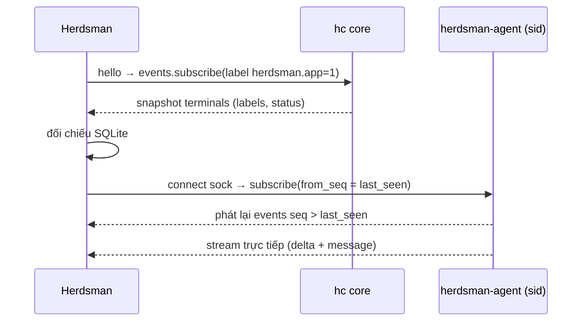
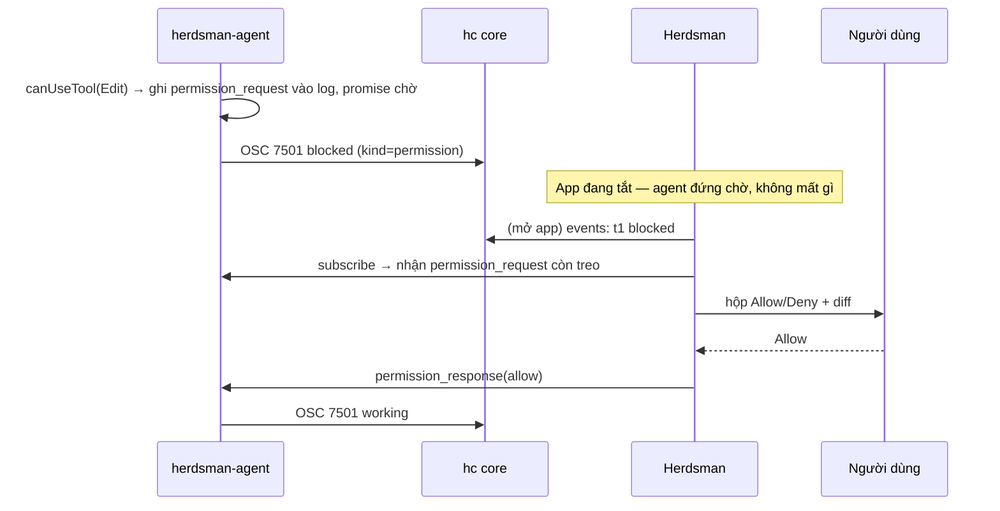

# Technical Architecture — Herdsman

## 1. Quyết định chính

| # | Quyết định | Lý do |
|---|---|---|
| D1 | **Engine Claude = Claude Agent SDK** (`@anthropic-ai/claude-agent-sdk`), không chạy Claude Code dạng TUI | Có stream chính thức (kể cả chữ đang chạy dở), callback `canUseTool` để duyệt quyền, không phải đọc transcript hay đọc màn hình |
| D2 | **Runtime = `hc` (herdr-core)** | Session sống qua việc tắt app, update và restart. Đã kiểm chứng với `hc` 0.1.21 |
| D3 | **Mỗi session là một tiến trình `herdsman-agent` (sidecar Node) chạy trong một terminal của `hc`** | Sidecar không phải tiến trình con của app, nên tắt app thì agent vẫn chạy (khác Devdy) |
| D4 | **App ↔ sidecar qua Unix socket + event log** | App mở lại thì nối vào socket, phát lại từ log, rồi nhận stream trực tiếp |
| D5 | **Engine adapter**: UI chỉ biết `AgentEvent` chuẩn hoá (theo định dạng stream-json của Claude) | Codex (`codex app-server`) dùng chung UI qua adapter, giống cách Devdy đang làm |
| D6 | **Adapter trong `sidecar/`**: Claude Agent SDK và Codex App Server dùng chung giao thức NDJSON và giao diện hội thoại, trạng thái và duyệt quyền | Mỗi engine giữ lịch sử gốc, còn Herdsman lưu event để kết nối lại |
| D8 | **Project → Workspace → Session**: workspace giữ một thư mục làm việc (thư mục project hoặc `git worktree` trên branch mới hoặc branch local chưa được checkout); mọi session của workspace chạy trong thư mục đó | Khớp BR F11 và constitution VI; worktree cho phép nhiều workspace chạy song song trên cùng repo mà không đè file |
| D9 | **Giao diện = shadcn/ui minimal** (Tailwind CSS v4, Radix, lucide-react, font Geist/Geist Mono đóng gói kèm app) | Khớp thiết kế đã chọn (BR 3.2); component nằm trong repo nên tuỳ biến được; chạy offline |
| D10 | **3 chế độ quyền theo session** ánh xạ thẳng sang `permissionMode` của SDK (`default` / `acceptEdits` / `bypassPermissions`) | Dùng cơ chế có sẵn của engine, không tự chặn tool ở app (constitution V) |
| D7 | **Frontend = React + TypeScript, state bằng Zustand** (server state qua TanStack Query) | Hệ sinh thái component lớn (virtual list, CodeMirror, xterm.js đều có binding React); Zustand nhẹ, không cần Provider, cho phép subscribe theo selector nên stream delta chỉ re-render đúng message đang chạy |

## 2. Tổng quan

```mermaid
flowchart LR
  subgraph App["Herdsman.app (Tauri) — tắt/mở thoải mái"]
    UI["WebView UI<br/>React + TS + Zustand"]
    RS["Rust backend"]
    UI <-->|invoke / events| RS
  end

  subgraph Core["hc core — sống độc lập (launchd)"]
    subgraph T1["terminal t1 · labels herdsman.*"]
      SC1["herdsman-agent (Node)<br/>Claude Agent SDK"]
    end
    subgraph T2["terminal t2"]
      SC2["herdsman-agent<br/>codex app-server adapter"]
    end
    T3["terminal t3: bun dev"]
  end

  RS <-->|JSON-RPC: run / list / events| Core
  RS <-->|unix socket per session<br/>subscribe(from_seq) / prompt / permission| SC1
  RS <-->|unix socket| SC2
  SC1 -->|append| LOG1[("events.ndjson")]
  SC1 -->|OSC 7501 status| Core
  SC1 --> CC["Claude Code engine<br/>(bên trong SDK)"]
  CC --> J1[("~/.claude/projects/…/sid.jsonl")]
  RS --> DB[("SQLite<br/>projects, sessions, accounts")]
```

| Tầng | Công nghệ | Trách nhiệm |
|---|---|---|
| UI | Tauri 2 WebView, React 18 + TypeScript, Zustand, TanStack Query, Tailwind v4 + shadcn/ui | Project/workspace, conversation view, input, permission |
| Backend | Rust (tokio, serde, sqlx) | `hc` client, sidecar client, store, git worktree, tìm kiếm FTS5 |
| Runtime | `hc` (người dùng tự cài) | Giữ tiến trình sidecar sống, status |
| Agent | `herdsman-agent` (Node, đóng gói kèm app) | Chạy Agent SDK, ghi event log, phục vụ socket, báo status |
| Dữ liệu app | SQLite + `<app data>/sessions/<sid>/` | Projects, workspace, session, account, chỉ mục tìm kiếm; event log của từng session |

## 3. `herdsman-agent` (sidecar)

Port từ `devdy/sidecar/index.mjs`, thêm phần persistence.

### 3.1 Khởi chạy qua `hc`
```text
terminal.run {
  argv: ["node", "<Resources>/herdsman-agent.mjs",
         "--session", sid, "--cwd", workspace.work_dir, "--engine", "claude",
         "--permission-mode", mode,
         "--resume"?   # khi tiếp tục một session cũ
  ],
  cwd: workspace.work_dir,          # thư mục project hoặc worktree của workspace
  outlive_parent: true,
  env: { CLAUDE_CONFIG_DIR: <account dir> },          # auth theo tài khoản, như Devdy
  labels: { herdsman.app=1, herdsman.kind=session, herdsman.project=<pid>, herdsman.workspace=<wid>, herdsman.session=<sid>, herdsman.engine=claude }
}
```
- `node` đóng gói kèm app (Tauri sidecar binary) để không phụ thuộc Node của máy. Agent SDK dùng engine Claude Code có sẵn trong package; có thể trỏ sang `claude` đã cài bằng `pathToClaudeCodeExecutable`.
- Label nằm trong `hc`, nên mất DB vẫn dựng lại được danh sách project/workspace/session từ `terminal.list`. Danh sách label đầy đủ: `specs/archive/001-herdsman-use-cases/contracts/hc-integration.md`.

### 3.2 Bên trong sidecar
```text
query({ prompt: <AsyncIterable input>, options: {
  cwd, resume: sid?, includePartialMessages: true,
  canUseTool, mcpServers, permissionMode, model, ... } })
```
| Việc | Cách làm |
|---|---|
| Hội thoại nhiều lượt | Input dạng async iterable; message mới từ socket được đẩy vào hàng đợi |
| Event log | Mọi message của SDK được gán `seq` tăng dần, append vào `<app data>/sessions/<sid>/events.ndjson`. `stream_event` (delta chữ) **chỉ gửi trực tiếp, không ghi log** cho nhẹ; message hoàn chỉnh mới được ghi |
| Ảnh đính kèm | Sidecar lưu ảnh trong thư mục `<app data>/sessions/<sid>/images/` trước khi append tin nhắn. Log chứa loại ảnh và mã tham chiếu, còn app đọc ảnh theo session khi hiển thị hàng tương ứng. |
| Socket | `<app data>/sock/<sid>.sock`. Lệnh: `subscribe{from_seq}`, `prompt{text, images}`, `interrupt`, `permission_response{id, decision, updatedInput?}`, `set_model`, `set_permission_mode`, `shutdown` |
| Chế độ quyền | `permissionMode` theo session: `default` (hỏi mọi lần, mặc định), `acceptEdits` (tự cho phép sửa file trong `cwd`; lệnh shell vẫn hỏi), `bypassPermissions` (không hỏi; UI bắt xác nhận và hiện badge cảnh báo). Đổi lúc chạy bằng `set_permission_mode` |
| Duyệt quyền | `canUseTool` tạo request `{id, tool, input}`, ghi vào log và gửi cho app nếu app đang nối. Promise **chờ không giới hạn** đến khi có quyết định (app mở lại vẫn trả lời được) |
| Báo status cho `hc` | Ghi chuỗi OSC 7501 ra stdout của terminal: `working` / `idle` / `done` / `blocked` (kind `permission` hoặc `question`) / `error`. Lượt thành công báo `idle` với kind `turn_complete`. Nếu `hc` chỉ trả `idle`, app đối chiếu lượt gần nhất trong event log để khôi phục tín hiệu. Tab Session hiển thị `Done` cho lượt thành công chưa xem. Chọn tab hoặc trở lại cửa sổ Herdsman với tab đó đang mở chuyển chỉ báo về `Idle`. Lượt mới hoàn thành trong phiên đang hiển thị ở cửa sổ có focus tự chuyển chỉ báo về `Idle`. Dấu đã xem lưu theo số thứ tự lượt hoàn thành của từng phiên. Phiên vẫn sẵn sàng nhận prompt tiếp theo. Trạng thái cấp phiên `done` được dùng khi sidecar tắt hoặc khi runtime xác nhận terminal đã dừng thành công. Nhờ vậy `hc ls`, Herdr và `hc wait` của agent khác đều thấy đúng trạng thái |
| Màn hình terminal | In log dạng chữ dễ đọc (ai nói gì, tool nào chạy) để `hc read` / `hc attach` vẫn có ý nghĩa |
| Nhận tin từ agent khác | Đọc stdin theo dòng: text do `hc send` dán vào được coi như một prompt mới. Agent khác giao việc qua `hc send <t>` như bình thường |
| Dừng | `interrupt` gọi `query.interrupt()`; `shutdown` đóng input rồi thoát, terminal chuyển sang `finished` |

### 3.3 Khi sidecar chết (crash, reboot)
Transcript của Claude Code (`~/.claude/projects/…/<sid>.jsonl`) vẫn còn. App thấy terminal `finished` hoặc bị mất, thì cho phép **Resume**: chạy lại sidecar với `--resume`, SDK nạp lại session (`resume: sid`). Event log được nối tiếp, `seq` không reset.

## 4. Backend Rust

### 4.1 `hc_client`
- Nối socket của `hc` (lấy từ `hc server status`; dự phòng `hc connect` qua stdio), gửi `hello`, kiểm tra protocol generation 1.
- `events.subscribe` lọc theo label `herdsman.app=1`: nhận created / status / finished / lost.
- Sinh type Rust từ `hc schema` (OpenRPC) để không lệch API.

### 4.2 `agent_client`
- Mỗi session đang hiển thị giữ một kết nối socket tới sidecar: `subscribe{from_seq = last_seen}`, nhận phần phát lại rồi tới stream trực tiếp. Sự kiện được đẩy lên UI theo batch khoảng 16–50 ms.
- Socket không nối được trong khi `hc` báo terminal vẫn live: retry với backoff. Terminal đã `finished`: có thể đọc lịch sử từ log trên đĩa và hiện nút Resume.
- Không mở session nào thì app không nối socket, chỉ theo dõi status qua `hc` events (cho badge và notification).

### 4.3 `project_store` (SQLite)
```sql
projects(id, name, path UNIQUE, created_at, sort)
workspaces(id, project_id, name NULL,
           dir_kind /*project|worktree*/, work_dir, branch NULL, base_branch NULL,
           archived_at NULL, worktree_removed, created_at)
sessions(id /*= Claude session id*/, workspace_id, engine, account_id, hc_terminal,
         title, status, permission_mode /*ask|accept_edits|bypass*/, model,
         last_seen_seq, pinned_tab, created_at, updated_at, ended_at)
accounts(id, label, engine, config_dir, uses_api_key)   -- CLAUDE_CONFIG_DIR theo tài khoản
message_fts USING fts5(session_id, workspace_id, project_id, seq, text)  -- tìm kiếm
```
Không có bảng spaces. Đơn vị tổ chức là Project (thư mục local) → Workspace → Session. Chi tiết trường, ràng buộc và vòng đời: `specs/archive/001-herdsman-use-cases/data-model.md`.

### 4.4 `git` (worktree)
- Tạo: `git -C <project> worktree add -b <branch> <path> <base>`, `<path>` = `<project>/../.herdsman-worktrees/<project-name>/<workspace-slug>`; không ghi được thì dùng `<app data>/worktrees/…`.
- Kiểm tra thay đổi chưa commit: `git -C <wt> status --porcelain`; xoá: `git worktree remove` (thêm `--force` chỉ sau khi người dùng xác nhận).
- Dùng CLI `git` (không dùng libgit2) để giữ hook, config và credential của người dùng.

### 4.5 Xoá và archive
- Archive workspace: đặt `archived_at`, ẩn khỏi sidebar, giữ lịch sử và chỉ mục tìm kiếm; có tuỳ chọn xoá worktree.
- Xoá workspace/project: xoá dữ liệu app (SQLite, `<app data>/sessions/<sid>/`), **không** đụng thư mục project và transcript `~/.claude`, `~/.codex`.
- Xoá project: liệt kê terminal `hc` có label `herdsman.project=<pid>` còn live → hộp xác nhận → `terminal.kill` → `terminal.rm`.

### 4.6 Tìm kiếm
SQLite FTS5 (`message_fts`) lập chỉ mục cho mỗi message hoàn chỉnh. Menu ⌘K tìm theo tiêu đề hoặc nội dung, cho phép chọn workspace hiện tại, project hiện tại hoặc toàn bộ session, gồm cả workspace đã archive. Phạm vi được áp dụng trước giới hạn kết quả. Với lịch sử Claude đã liên kết, ID hội thoại xác định vị trí thông qua session Herdsman. Với hội thoại ngoài Herdsman, vị trí được xác định theo thư mục khi có thể. Menu có các tab All, Workspaces, Projects, Actions và Settings, giữ từ khóa khi đổi tab hoặc phạm vi và hiển thị riêng trạng thái tải, lỗi và không có kết quả.

## 5. Frontend

### 5.1 Bố cục
```text
┌ Sidebar ──────┐┌ project › workspace · ⎇ branch · status · model · ctx ┐┌ Panel phải ─┐
│ + Project mới ││ [s1 ●] [s2 ◐] [+]                        [lịch sử]   ││ Agents      │
│ ▾ app-a    +  ││                                                       ││ Background  │
│   ⎇ fix-123 ● ││  conversation (virtual list, stream delta)            ││ Git         │
│   ▢ refactor  ││  ...                                                  ││ Log         │
│ ▸ app-b    +  ││ ┌ input: text / ảnh / slash · chế độ quyền ─────────┐ ││             │
│ hc ● · ⚙      ││ └───────────────────────────────────────────────────┘ ││             │
└───────────────┘└───────────────────────────────────────────────────────┘└─────────────┘
```
- Sidebar: project → workspace (⎇ = worktree, ▢ = thư mục project, chấm vàng = có session chờ).
- **Codex** dùng bản CLI cục bộ trên máy, đã kiểm tra với 0.171.0. Session chạy App Server trong sidecar thuộc terminal `hc`. Menu workspace có **Codex** để tạo phiên. Sidecar kiểm tra đăng nhập trên App Server của phiên trong lúc tab mở. Hai chế độ quyền là **Ask before editing** (chỉ đọc mặc định) và **Workspace write**. Khi Codex yêu cầu thêm quyền, Herdsman chuyển quyết định của người dùng qua App Server.

- **Files** nằm cạnh **Git** ở panel phải và tải cây từ thư mục gốc của project đang chọn. **Git** hiển thị thay đổi của workspace. Tab file dùng CodeMirror 6 để xem và sửa văn bản.
- Đường dẫn tệp trong Rich Conversation mở tab tệp của workspace. Đường dẫn tương đối dùng thư mục làm việc của session, kể cả worktree riêng. Nếu không mở được, hội thoại giữ vị trí đọc và hiển thị lỗi.
- Tab Markdown có chế độ **Preview** dùng chung bộ hiển thị với Rich Conversation. **Download** mở hộp thoại lưu của hệ điều hành và ghi bản sao của nội dung đang xem, kể cả thay đổi chưa lưu.
- Ô tìm trong **Files** khớp một phần tên hoặc đường dẫn tương đối, không phân biệt hoa thường. Kết quả bao gồm file trong thư mục đang thu gọn và mở qua cùng luồng tab file. Xóa ô tìm trả về cây với các thư mục đã mở.
- Đường dẫn tuyệt đối nhập trong **Files** hiện thành một hàng kết quả. Có thể nhấn Enter hoặc chọn hàng file trong kết quả để mở đúng file. File ngoài project mở ở chế độ chỉ đọc.
- Dán đường dẫn tuyệt đối của thư mục để xem các file trực tiếp trong thư mục đó. Thêm `/<truy vấn>` để lọc trong thư mục và các thư mục con.
- Hàng tab gồm các terminal của workspace, file đang mở, session chưa xong và session đang xem. Session đã xong mở lại từ lịch sử thành tab tạm.
- **Terminal** chạy shell mặc định trong thư mục làm việc của workspace bằng hc. App tìm lại shell qua label project và workspace. Terminal dùng **Code font** và **Code font size** trong Appearance. xterm.js nhận output và gửi input, resize qua Tauri tới PTY của trình xem `hc attach`. Đổi tab hoặc tắt app kết thúc trình xem. Shell do core giữ cho tới khi thoát hoặc người dùng chọn dừng.
- **Log** hiển thị màn hình terminal của sidecar (xterm.js qua `terminal.attach`), dùng để debug. Không còn TUI của Claude Code.

### 5.1b Giao diện (shadcn/ui minimal)
- Tailwind CSS v4 + shadcn/ui (component copy vào `src/components/ui`), Radix, `lucide-react`.
- Token màu thang zinc khai báo bằng CSS variables cho Light/Dark (giá trị trong BR 3.2); theme mặc định theo hệ điều hành, đổi bằng nút ở sidebar.
- Font Geist (giao diện) và Geist Mono (code, đường dẫn, branch, log, số liệu) đóng gói kèm app.

### 5.2 Render hội thoại
| Thành phần | Thư viện |
|---|---|
| Markdown | `react-markdown` + `remark-gfm` (không dùng `dangerouslySetInnerHTML`; HTML thô nếu cho phép thì qua `rehype-sanitize`) |
| Chữ đang chạy dở | Ghép `stream_event` (text delta) vào message tạm, thay bằng message hoàn chỉnh khi có |
| Code | Shiki (lazy theo ngôn ngữ) |
| Mermaid | `mermaid` render trong worker, cache theo hash + theme, zoom/pan; lỗi thì hiện lại source |
| Biểu đồ | Khối ` ```chart ` (Vega-Lite) → `vega-embed` |
| Toán | KaTeX |
| Tool call | Card thu gọn được: `Bash`, `Edit/Write` (diff bằng `@codemirror/merge`), `Read`, `Task` (sub-agent) |
| Danh sách dài | Virtual scroll (`@tanstack/react-virtual`); Mermaid/chart chỉ render khi lọt vào viewport |

Có thể truyền thêm `systemPrompt` / output style để agent ưu tiên trả về Mermaid và khối ` ```chart ` khi phù hợp.

### 5.3 State (Zustand)
| Store | Nội dung | Ghi chú |
|---|---|---|
| `useProjectStore` | Danh sách project/workspace, project/workspace/session đang chọn | Dữ liệu SQLite lấy qua TanStack Query (`invoke`); store chỉ giữ lựa chọn UI, có `persist` cho lựa chọn gần nhất |
| `useSessionStore` | Theo từng `sid`: `messages` (theo `seq`), message tạm đang stream, `lastSeenSeq`, trạng thái | Event batch từ Rust (`listen`) được gộp bằng một action `applyEvents(sid, events)`; component subscribe theo selector (`s => s.sessions[sid].messages[i]`) để delta chỉ re-render message đang chạy |
| `usePermissionStore` | Hàng đợi `permission_request` còn treo theo session, chế độ quyền của session | Dùng cho chấm trạng thái, hộp Allow/Deny và badge cảnh báo chế độ bypass |
| `useStatusStore` | Status từ `hc` events (idle / working / blocked / done / error) của mọi session | Có cả khi session chưa mở, phục vụ sidebar và notification |

Thông báo hoàn thành dùng số thứ tự và thời điểm của lượt `turn_end` thành công. Cửa sổ gửi một thông báo native có âm cho mỗi lượt mới, bỏ qua kết quả trước khi mở và thông tin nhận trùng. Trên macOS, thông báo dùng âm hệ thống Tink. Khi mở Herdsman.app hoặc bật thông báo hoàn thành hay tiếng báo trong Settings, ứng dụng yêu cầu quyền cảnh báo và âm thanh. macOS chỉ hiện hộp thoại nếu người dùng chưa quyết định. Tiến trình dev chạy ngoài gói ứng dụng dùng định danh Terminal và không yêu cầu quyền lúc mở. **Settings → Notifications** lưu tùy chọn gửi thông báo hoàn thành và phát tiếng báo trong cài đặt cục bộ của giao diện. Tắt âm vẫn gửi thông báo im lặng. Hai tùy chọn không áp dụng cho thông báo cần duyệt hoặc báo lỗi.

- Dùng middleware `immer` cho cập nhật lồng nhau và `subscribeWithSelector` để hiệu ứng ngoài React (notification, lưu `lastSeenSeq`) theo dõi thay đổi.
- Không đưa state của sidecar vào store toàn cục khi không mở session đó; đóng tab thì giải phóng `messages` (lần sau phát lại từ event log).

## 6. Luồng chính

**Mở app, khôi phục session:**


**Duyệt quyền khi app đang tắt:**


## 7. Xác thực

- Mặc định giống Devdy: mỗi tài khoản Claude có một `CLAUDE_CONFIG_DIR` riêng (đăng nhập subscription một lần trong thư mục đó). Khi đã chọn tài khoản thì xoá các biến `ANTHROPIC_API_KEY`, `ANTHROPIC_AUTH_TOKEN`, `CLAUDE_CODE_OAUTH_TOKEN` khỏi env của sidecar.
- Có thể chọn chạy bằng API key cho từng tài khoản (key lưu trong Keychain, chỉ truyền vào env của sidecar lúc chạy).
- **Lưu ý điều khoản:** dùng subscription qua Agent SDK cho mục đích cá nhân chạy được về kỹ thuật (Devdy đang làm vậy). Nếu phân phối Herdsman cho người khác, cần đọc lại điều khoản của Anthropic về đăng nhập claude.ai trong app bên thứ ba.

## 8. Lộ trình

| Phase | Nội dung |
|---|---|
| **MVP** | Port sidecar Claude từ Devdy + event log + socket + OSC 7501; chạy qua `hc`; Projects + Workspace (thư mục project) + SQLite; render stream (markdown/Mermaid/chart/tool card); input; permission 3 chế độ; Resume |
| **v1** | Trạng thái + notification, worktree + archive/xoá, history/search (FTS5), Log, terminal workspace, cây multi-agent, adapter Codex qua App Server, nhiều tài khoản |
| **v2** | Remote project (`hc machine` — sidecar chạy trên máy kia, socket qua `hc connect`), đồng bộ project qua `doc.set` |

## 9. Rủi ro & việc cần kiểm chứng

| Hạng mục | Trạng thái / giảm thiểu |
|---|---|
| `hc` giữ tiến trình sống, label, `terminal.list` lọc theo label, `send`, status | **Đã kiểm chứng** (2026-11-20, `hc` 0.1.21, chạy thử với Claude Code CLI) |
| Định dạng chuỗi OSC 7501 để sidecar tự báo status | **Cần kiểm chứng**. Schema của `hc` mô tả bản ghi `Status {state, kind, msg, progress, app}` nhưng không ghi cú pháp byte. Hỏi tác giả hoặc đọc mã nguồn `hc`; nếu không làm được thì chỉ dùng socket (Herdr / `hc wait` sẽ không thấy status) |
| Sidecar Node chạy trong `hc`, nối socket lại sau khi app khởi động lại | Cần làm PoC (ước lượng 1–2 ngày từ code Devdy) |
| `hc send` từ agent khác dán text vào sidecar | Sidecar đọc stdin theo dòng; text dài nhiều dòng cần quy ước (bracketed paste) — cần thử |
| Agent SDK thay đổi API giữa các bản | Cố định phiên bản, smoke test như `devdy/sidecar/test-smoke.mjs` |
| Hộp "trust folder" | Không xuất hiện với SDK (không có TUI); quyền do `canUseTool` + `permissionMode` quyết định |
| Event log phình to | Không ghi delta; xoay vòng log theo session; có thể dựng lại từ transcript của Claude Code |
| Điều khoản dùng subscription | Xem mục 7 |
| Không tạo được worktree cạnh repo (quyền thư mục) | Fallback `<app data>/worktrees/…`, báo trong UI |
